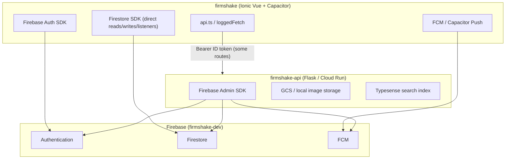
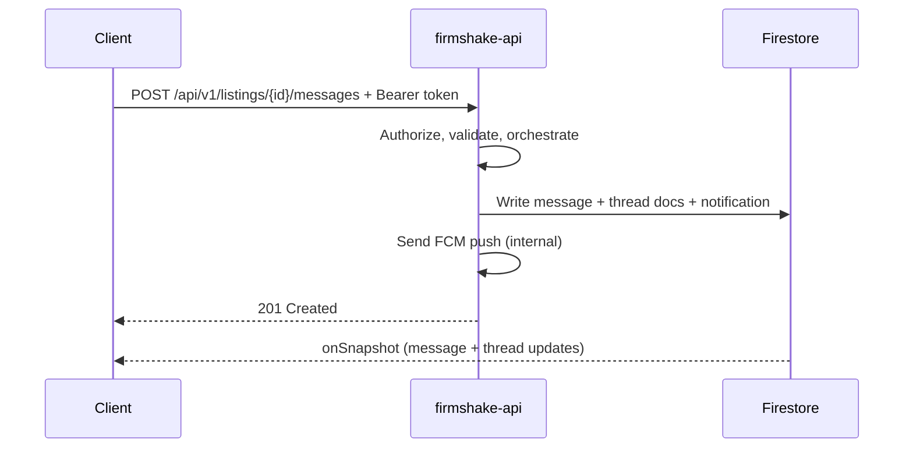

# FirmShake BFF Architecture Plan

This document describes the **Backend for Frontend (BFF)** strategy for FirmShake. The client is the Ionic Vue app in this repo; the server is **[firmshake-api](../firmshake-api)** (Flask on Cloud Run). See also [ARCHITECTURE.md](./ARCHITECTURE.md) for the current client architecture.

## Implementation Status

Last updated: **2026-08-06**

| Phase | Scope | Status | Notes |
|---|---|---|---|
| **0** | Harden existing API (auth on sync, push relationship checks, rate limits) | ✅ Complete | Deployed to staging |
| **1** | Listing create/update/remove BFF | ✅ Complete | `POST/PATCH /api/v1/listings`, client `listingServiceRouter` |
| **2** | Messaging BFF (send + thread sync + notify) | ✅ Complete | `POST /api/v1/listings/{id}/messages`; inbox endpoints deferred to Phase 5 |
| **3** | Agreements & deposit pipeline | ✅ Complete | `/api/v1/agreements/*`, Stripe webhook stub |
| **4** | Profile, communities, blocks, moderation | ✅ Complete | `userServiceRouter`, `communityServiceRouter`, `blockServiceRouter` wired into services |
| **5** | Optional read migration + rules tightening | ✅ Complete | Inbox BFF endpoints + `inboxServiceRouter` wired; browse `GET /api/v1/listings` (API only); Firestore deny rules documented but not enforced |

### Phase 5 checklist (2026-08-06)

- [x] `GET /api/v1/inbox/threads` — paginated enriched threads
- [x] `POST /api/v1/inbox/threads/{key}/read|archive|unarchive`
- [x] `services/inbox_pipeline.py` + API tests
- [x] Client stubs: `inboxBff.ts`, `inboxServiceRouter.ts`, `useBffInbox()` (default **false**)
- [x] `GET /api/v1/listings` browse endpoint (API only; client still uses Firestore)
- [x] Firestore rules: commented deny blocks + rollout comments (not enforced — prod flags off)
- [x] Wire `inboxServiceRouter` into Inbox/Buying/Selling pages + overflow menu + message view
- [ ] Enable `VITE_USE_BFF_INBOX` in staging after manual QA (flag stays **false** by default)
- [ ] Uncomment Firestore write-deny rules after all domain flags are on in production

### Rollout instructions

Enable BFF domains incrementally via env / CI secrets. Recommended order:

1. **Staging smoke** — set flags in `.env.local` or GitHub Actions secrets one domain at a time; verify create/send/agreement/profile/inbox flows.
2. **Production opt-in** — uncomment the matching flag in deploy env only after staging QA passes for that domain.
3. **Firestore deny rules** — after **all** production clients run with a domain flag on, uncomment the corresponding deny block in `firestore.rules` and deploy rules only (`firebase deploy --only firestore:rules`).

| Flag | Default (prod) | Client router | API routes |
|---|---|---|---|
| `VITE_USE_BFF_LISTINGS` | false (dev: on if API configured) | `listingServiceRouter` | `POST/PATCH /api/v1/listings` |
| `VITE_USE_BFF_MESSAGES` | false | `messageServiceRouter` | `POST /api/v1/listings/{id}/messages` |
| `VITE_USE_BFF_AGREEMENTS` | false (dev: on if API configured) | `agreementServiceRouter` | `/api/v1/agreements/*` |
| `VITE_USE_BFF_USERS` | false (dev: on if API configured) | `userServiceRouter`, `blockServiceRouter`, `communityServiceRouter` | `/api/v1/users/*`, `/api/v1/communities/*` |
| `VITE_USE_BFF_INBOX` | false | `inboxServiceRouter` | `/api/v1/inbox/*` |

**Intentionally deferred:** Stripe live payments, Firestore deny-rule enforcement, distributed rate limits (see Security Checklist).

### Firestore rules rollout (safe mode)

Deny rules for `listings`, `listings/messages`, and `agreements` client writes are **prepared as comments** in `firestore.rules`. Do **not** uncomment until the corresponding `VITE_USE_BFF_*` flag is enabled for all production clients:

| Collection | Flag | Current prod default |
|---|---|---|
| `listings` create/update | `VITE_USE_BFF_LISTINGS` | false (explicit opt-in) |
| `listings/messages` create | `VITE_USE_BFF_MESSAGES` | false |
| `agreements` create/update | `VITE_USE_BFF_AGREEMENTS` | false (explicit opt-in) |

**Kept writable:** `users/{uid}/inboxState`, `users/{uid}/fcmTokens` (owner-only).

**Status:** Phases 0–5 client integration complete — staged rollout via feature flags (see Rollout instructions above).

## Executive Summary

FirmShake today is a **hybrid architecture**: the Ionic Vue client talks **directly to Firestore** for most product data, while **firmshake-api** handles privileged operations (images, geo ETA, search index, push delivery, reCAPTCHA, admin/controlpanel). Firebase Auth remains entirely client-side; the API validates Firebase ID tokens via Admin SDK.

The recommended BFF strategy is **not a greenfield rewrite**. Evolve **firmshake-api** into the canonical Backend-for-Frontend: keep Firebase Auth on the client, keep Firestore listeners where real-time UX matters, and progressively move **mutations, orchestration, authorization, and sensitive reads** behind authenticated API endpoints. Tighten Firestore rules to a **read-mostly + user-private subcollections** model as writes migrate.

---

## Current Data Access Architecture

### Architecture Diagram (Today)



### Firebase / Firestore (Primary Data Plane)

**Initialization:** `src/common/services/firebase.ts`

- Auth with `browserLocalPersistence`
- Firestore with IndexedDB persistence (multi-tab on web, single-tab on native)
- Connection reset on logout/user-switch via `resetFirestoreConnection()`

**Auth coordination:** `src/common/services/firestoreAuth.ts`, `src/common/services/idToken.ts`

- Deduped ID token fetch (2s timeout, 60s force-refresh cooldown)
- `waitForFirestoreAuth()` — full path with Firestore probe (writes)
- `waitForFirestoreAuthNavigation()` — fast path (router/tabs)
- Retriable snapshots for transient permission-denied during auth propagation

**Security rules:** `firestore.rules`

| Collection / Path | Guest read | Auth read | Client write |
|---|---|---|---|
| `listings/{id}` | active only | all (incl. removed for participants) | create (seller), update (seller/moderator removal) |
| `listings/{id}/messages` | — | seller (all msgs) or participant pair | create only |
| `users/{uid}` | — | **any signed-in user** | own profile; moderator field changes |
| `users/{uid}/inboxState`, `threads`, `blockedUsers`, `fcmTokens`, `notifications` | — | owner (+ blocked user can read block doc) | owner |
| `agreements/{id}` | — | buyer or seller | state transitions (rules-enforced) |
| `communities`, `categories`, `communityFeeds` | public read | public read | communities create; **feeds/categories write denied** |
| `images`, `platformBans`, `controlpanelOperators` | — | — | denied (server-only) |

**Important rule/client mismatch:** `communityFeeds/*/listings` has `allow write: if false`, but the client attempts feed sync in `src/features/listings/services/listingFeed.ts` (`syncListingFeeds`, `updateListingFeedStatus`). Writes fail silently (caught in try/catch); browse falls back to querying `listings` directly. Feed backfill is done via admin script `scripts/backfill-listing-feeds.mjs`.

### Existing API Layer (firmshake-api)

**Client wrapper:** `src/common/services/api.ts`  
**Base URL resolution:** `src/utils/apiBaseUrl.ts` (dev proxy, staging Cloud Run default)

| Endpoint | Auth | Called from | Purpose |
|---|---|---|---|
| `GET /health` | none | `checkApiHealth()` | API availability |
| `POST /api/auth/verify-recaptcha` | none | `recaptchaGate.ts` | Server-side reCAPTCHA verification |
| `POST /api/images` | Bearer | `uploadImage()` | Upload listing/profile photos |
| `GET /api/images/{id}` | Bearer (optional for some) | `images.ts`, `AuthenticatedImage.vue` | Serve private images |
| `GET /api/listings/search` | none | `listingSearch.ts` | Typesense search + geo filter |
| `POST /api/listings/sync` | **none today** | `listingSearch.ts` `syncListingSearchIndex()` | Upsert search index document |
| `POST /api/meetups/{id}/location` | Bearer | `locationTracking.ts` | GPS → ETA/progress (coords never stored on agreement for other party) |
| `POST /api/notifications/push` | Bearer | `notifications.ts` | FCM multicast |
| `POST /api/controlpanel/check-ban` | none | `platformBanCheck.ts` | Pre-login ban check (fail-open on outage) |
| `/api/controlpanel/*` | Bearer + operator ACL | separate controlpanel app | Admin: bans, test accounts, operators |

**API auth implementation:** `../firmshake-api/services/auth.py` — `verify_firebase_token()` via Firebase Admin `auth.verify_id_token()`.

**Deployment:** Cloud Run staging (`firmshake-api-staging-858269838319.us-central1.run.app`), CORS via `CORS_ORIGINS` env.

### Firebase Auth Flow (Stays Client-Side)

**Primary module:** `src/features/auth/services/auth.ts`

| Flow | Mechanism | Firestore touchpoints |
|---|---|---|
| Email register | `createUserWithEmailAndPassword` + reCAPTCHA + ban check | `ensureUserProfile()` → `users/{uid}` create |
| Email login | `signInWithEmailAndPassword` | profile read, bootstrap |
| Google login/register | popup/redirect | profile create if new |
| MFA enroll/challenge | `src/features/auth/services/mfa.ts` (SMS via Firebase MFA) | post-MFA Firestore session reset |
| Password reset | `src/features/auth/services/passwordReset.ts` — email link sign-in, not `sendPasswordResetEmail` | MFA before new password |
| Session maintenance | `src/features/auth/services/sessionExpiry.ts` | proactive 12h token refresh, permission-denied → session expired |
| Logout / user switch | `resetFirestoreConnection()`, clear token caches | — |

**MFA consideration for BFF:** MFA is enforced by Firebase Auth before a valid ID token is issued. The BFF does **not** need separate MFA verification — it validates the JWT and can optionally check `firebase.sign_in_second_factor` claims when stricter policies are needed.

### Push Notifications

1. **Token registration (client → Firestore):** `src/common/services/pushNotifications.ts` writes `users/{uid}/fcmTokens/{hash}`
2. **In-app notification docs (client → Firestore):** `src/features/messages/services/notifications.ts` `createNotification()`
3. **Push delivery (client → API → FCM):** `sendPushNotification()` in `api.ts` → `../firmshake-api/services/push.py`

### Storage

No Firebase Storage rules in this repo. Images are stored in **private GCS** (or local disk in dev) via firmshake-api. Client never gets permanent public URLs; protected images require Bearer token (`src/common/services/images.ts`).

### Real-Time Listeners (Firestore `onSnapshot`)

~29 listener call sites across:

| Domain | Service file | What updates live |
|---|---|---|
| Inbox threads | `src/features/messages/services/threads.ts` | `users/{uid}/threads` |
| Messages | `src/features/messages/services/messages.ts` | `listings/{id}/messages` (participant-filtered client-side) |
| Notifications | `src/features/messages/services/notifications.ts` | `users/{uid}/notifications` |
| Inbox state | `src/features/messages/services/inboxState.ts` | archive/read state |
| Blocked users | `src/common/services/blocks.ts` | block list |
| Agreements | `src/common/services/agreements.ts` | FirmShake status, ETA fields |
| Seller listings | `src/features/listings/services/listings.ts` | active seller listings |
| User profile | `src/common/services/users.ts` | own profile |
| Categories | `src/features/listings/services/categories.ts` | category list |

Client-side caching (SWR): `src/common/services/responseCache.ts`, tab feed caches, browse cache.

---

## Feature Domain Catalog

### Listings (Browse, Create, Detail, Search, Geo)

| Operation | Current path | Collections / API |
|---|---|---|
| Browse paginated feed | `listingFeed.ts` → `fetchBrowsePage()` | Read `communityFeeds/{communityId}/listings` (fallback: `listings`) |
| Geo/text search | `listingSearch.ts` | `GET /api/listings/search` (Typesense) |
| Search index sync | `syncListingSearchIndex()` | `POST /api/listings/sync` (**unauthenticated**) |
| Get by ID / batch | `listings.ts` `getListingsByIds()` | `listings` (batched `in` queries, 30 IDs) |
| Create listing | `listings.ts` `createListing()` | Write `listings`; attempted feed sync; search sync |
| Update listing | `updateListing()` | Write `listings`; feed/search sync |
| Remove listing | `removeListing()` | Status update; client-side moderation check via `moderation.ts` |
| Photo upload | `api.ts` `uploadImage()` | API → GCS; returns `/api/images/{id}` URL |
| Seller listing subscription | `subscribeSellerListings()` | Firestore listener |
| Categories | `categories.ts` | Read `categories`; client seed attempt (rules deny write) |

**Geo:** Listing location stored on Firestore doc; geo search via API/Typesense. Meetup live GPS goes through API only (`locationTracking.ts`).

### Messages / Threads / Inbox

| Operation | Service | Storage |
|---|---|---|
| Send message | `messages.ts` `sendListingMessage()` | `listings/{id}/messages` addDoc |
| Thread index update | `threads.ts` `syncMessageThreads()` | Writes to **both** participants' `users/{uid}/threads/{docId}` |
| Thread rebuild | `threads.ts` `rebuildThreadsForUser()` | Scans notifications + messageListings + seller listings |
| Inbox subscription | `subscribeInboxThreads()` | Listener on `users/{uid}/threads` |
| Message subscription | `subscribeListingMessages()` | Dual queries (sent/received) or seller full collection |
| Archive / read state | `inboxState.ts` | `users/{uid}/inboxState/{listingId or listingId_buyerId}` |
| Push + in-app notify | `notifications.ts` | Firestore notification doc + API push |

### Communities

| Operation | Service | Storage |
|---|---|---|
| List communities | `communities.ts` `fetchCommunities()` | `communities` (public read) |
| Seed system communities | `ensureCommunitiesSeeded()` | Client write (first creator wins for `all`) |
| Create user community | `createUserCommunity()` | `communities` addDoc + `joinCommunity()` |
| Join / leave | `users.ts` | Update `users/{uid}.communityIds` |
| Moderator management | `users.ts` + `CommunityModeratorPanel.vue` | Update target's `moderatorCommunityIds` (rules + client checks) |

### Meetups / FirmShakes (Agreements)

| Operation | Service | Storage |
|---|---|---|
| Propose | `agreements.ts` `proposeMeetupAgreement()` | `agreements` create |
| Accept / decline / cancel | various | Firestore merge updates |
| Deposit confirm | `confirmMeetupDeposit()` | status → `deposit_paid` (mock; Stripe planned) |
| En route | `startMeetupEnRoute()` | status → `en_route` |
| Live location | `locationTracking.ts` → API | API writes ETA fields only |
| Subscriptions | `subscribeAgreement()`, buyer/seller agreement listeners | Firestore |
| Block side effect | `cancelActiveAgreementOnBlock()` | Agreement cancel on block |

### User Profile, Blocks, Inbox State

| Operation | Service | Notes |
|---|---|---|
| Profile CRUD | `users.ts`, `auth.ts` | Any authed user can **read any profile** (email, names, moderator flags visible) |
| Profile photo | `updateUserPhotoUrl()` + API image upload | |
| Block / unblock | `blocks.ts` | `users/{blocker}/blockedUsers/{blocked}` |
| Block checks | client + Firestore rules on message create | |
| FCM tokens | `pushNotifications.ts` | Per-user subcollection |

### Auth Flows

| Flow | Key files | Server involvement |
|---|---|---|
| Register | `auth.ts`, `recaptchaGate.ts`, `platformBanCheck.ts` | reCAPTCHA verify, ban check |
| Login | `auth.ts`, MFA challenge | ban check |
| MFA enroll/challenge | `mfa.ts` | Firebase only |
| Password reset | `passwordReset.ts` | reCAPTCHA on send link |
| Complete profile | `users.ts`, `CompleteProfilePage.vue` | Firestore write |
| Platform ban enforcement | API check at login; `platformBans` collection is server-only | |

### Admin / Moderation

| Surface | Location | Access |
|---|---|---|
| In-app moderation | `moderation.ts`, listing removal in `listings.ts` | Super-admin or community moderator (client + rules) |
| Community moderators | `CommunityModeratorPanel.vue`, `users.ts` | Grant/revoke `moderatorCommunityIds` |
| Control panel | `../firmshake-api/routes/controlpanel.py` | Separate web app; operator ACL in Firestore |
| Test accounts, bans, test listings | controlpanel API | Admin SDK writes |

---

## Security Concerns with Direct-DB Approach

### High Severity

1. **Unauthenticated search index sync** — `POST /api/listings/sync` accepts arbitrary documents without auth (`listingSearch.ts` → `../firmshake-api/routes/listings.py`). Enables search index poisoning/spam.

2. **Notification spam vector** — Any authenticated user can create notification docs for any `recipientId` if `actorId == self` (`firestore.rules` lines 117–125). Combined with `/api/notifications/push`, this enables push spam to arbitrary users.

3. **Push API lacks relationship validation** — API verifies token but does not verify actor/recipient share a listing thread, agreement, or message context.

4. **Over-broad profile reads** — `users/{userId}` readable by any signed-in user exposes email, moderator flags, community memberships.

5. **Seller reads entire message subcollection** — Rules allow seller to read all messages on a listing, not scoped per buyer thread (privacy between buyers).

6. **Agreement state machine on client** — Deposit confirmation (`deposit_paid`) is a client Firestore write with no payment verification (acceptable for mock milestone, unacceptable for production Stripe).

7. **Thread index cross-user writes** — Rules allow thread doc create/update when `updatedBy == request.auth.uid`, enabling any participant to write denormalized data into another user's thread doc (needed for sync, but abusable for content injection).

### Medium Severity

8. **Community feed writes blocked but client attempts them** — Denormalization drift; reliance on fallback queries and manual backfill scripts.

9. **Client-side authorization duplication** — Moderation, block checks, agreement transitions duplicated in TS (`moderation.ts`, `agreements.ts`) and rules; divergence risk.

10. **Ban check fails open** — `platformBanCheck.ts` intentionally allows login if API unreachable.

11. **Search endpoint unauthenticated** — Acceptable for public browse, but enables scraping/rate abuse without throttling.

12. **Categories seed from client** — Rules deny writes; depends on admin scripts or first-load fallbacks to hardcoded seeds.

13. **In-memory rate limiting only on image upload** — Not distributed across Cloud Run instances; no global API rate limits.

### Lower Severity / Operational

14. **Firestore rules complexity** — Message create rules with nested `get()`/`exists()` are expensive and hard to audit.

15. **Email lookup** — `findUserByEmail()` queries all users collection (moderator grant UI); exposes existence timing.

16. **No field-level security** — Clients receive full listing/user/agreement documents including internal fields.

---

## Recommended BFF Strategy

### Technology Choice

**Recommendation: Extend firmshake-api (Flask + Firebase Admin) as the BFF.**

Rationale:

- Already deployed on Cloud Run with Firebase Admin, GCS, Typesense, FCM
- Auth verification pattern exists (`../firmshake-api/services/auth.py`)
- Image pipeline, meetup ETA, push, controlpanel already implemented
- Product docs (`docs/ARCHITECTURE.md` in both repos) assume this split
- Stripe webhooks and penalty logic naturally live here

Optional future: extract shared **TypeScript types** from `src/types/index.ts` into an OpenAPI spec generated from Flask routes (or hand-maintained OpenAPI) for client codegen — not a new runtime.

**Not recommended now:** Separate Node BFF (duplicates Admin SDK integration), GraphQL layer (overhead for mobile client), or Firebase Callable Functions as primary BFF (splits logic across two server runtimes).

### BFF Responsibilities (Target State)

| Responsibility | BFF | Client Firestore |
|---|---|---|
| Firebase Auth (login/MFA) | — | Yes |
| ID token issuance | — | Yes |
| Mutations with side effects | Yes | No (eventually) |
| Payment / Stripe webhooks | Yes | No |
| Image storage | Yes | No |
| Search index maintenance | Yes (server-triggered) | No |
| Community feed denormalization | Yes | No |
| Notification creation + push | Yes | Read-only listener (optional) |
| Public browse read | BFF cache or Firestore | Guest Firestore read OK |
| Real-time message/agreement updates | Optional BFF SSE | Firestore listeners (recommended keep) |
| User-private state (inbox, archive) | BFF or Firestore | Firestore with strict rules |

---

## Proposed API Surface

Grouped by resource. Prefix: `/api/v1/` (version when breaking changes begin; keep existing routes during migration).

### Auth & Session (supplement Firebase, not replace)

```
POST /api/v1/auth/verify-recaptcha          # existing, keep
POST /api/v1/auth/check-ban                 # existing check-ban, consider auth-hardening
GET  /api/v1/auth/me                        # profile summary from Firestore (sanitized)
POST /api/v1/auth/register-complete         # post-Firebase-user profile finalize (optional consolidation)
```

### Users & Profile

```
GET    /api/v1/users/me
PATCH  /api/v1/users/me                     # name, photoUrl, communityIds
GET    /api/v1/users/{uid}/public           # displayName, photoUrl only (not email)
GET    /api/v1/users/by-email               # moderator admin only; rate limited
DELETE /api/v1/users/me                     # account deletion orchestration
```

### Blocks

```
GET    /api/v1/users/me/blocks
POST   /api/v1/users/me/blocks/{uid}
DELETE /api/v1/users/me/blocks/{uid}
```

### Communities

```
GET  /api/v1/communities
POST /api/v1/communities                    # user-created
POST /api/v1/communities/{id}/join
POST /api/v1/communities/{id}/leave
GET  /api/v1/communities/{id}/moderators    # moderators only
POST /api/v1/communities/{id}/moderators    # grant
DELETE /api/v1/communities/{id}/moderators/{uid}
```

### Listings

```
GET  /api/v1/listings                       # browse (communityId, filters, cursor)
GET  /api/v1/listings/search                # existing Typesense endpoint
GET  /api/v1/listings/{id}
POST /api/v1/listings                       # create + feed sync + search sync (transactional)
PATCH /api/v1/listings/{id}                 # seller update
POST /api/v1/listings/{id}/remove           # seller or moderator
GET  /api/v1/users/me/listings/selling      # paginated seller listings
```

### Images (existing)

```
POST /api/v1/images
GET  /api/v1/images/{id}
```

### Messages & Inbox

```
GET  /api/v1/inbox/threads                  # paginated, enriched
GET  /api/v1/listings/{id}/messages         # participant-scoped
POST /api/v1/listings/{id}/messages         # send + thread sync + notify (atomic server-side)
POST /api/v1/inbox/threads/{key}/read
POST /api/v1/inbox/threads/{key}/archive
POST /api/v1/inbox/threads/{key}/unarchive
POST /api/v1/inbox/rebuild                  # admin/debug or user-triggered repair
```

### Notifications

```
GET  /api/v1/notifications                  # paginated (alternative to listener)
PATCH /api/v1/notifications/{id}/read
POST /api/v1/notifications/read-all
# Push sending becomes INTERNAL only — removed from client-facing API
```

### FirmShakes / Agreements

```
GET  /api/v1/agreements/{id}
GET  /api/v1/agreements?role=buyer|seller&listingId=
POST /api/v1/agreements                     # propose
POST /api/v1/agreements/{id}/accept
POST /api/v1/agreements/{id}/decline
POST /api/v1/agreements/{id}/cancel
POST /api/v1/agreements/{id}/deposit        # Stripe session creation (future)
POST /api/v1/agreements/{id}/en-route
POST /api/v1/agreements/{id}/location       # existing ETA endpoint
POST /api/v1/webhooks/stripe                # deposits, penalties (future)
```

### Catalog (read-mostly)

```
GET /api/v1/categories
```

### Health

```
GET /health
```

### Control Panel (unchanged, separate app)

Existing `/api/controlpanel/*` remains separate from mobile BFF surface.

---

## Auth Architecture

### Frontend Authentication (Unchanged)

- Firebase Auth SDK handles register, login, Google OAuth, MFA, password reset
- Client obtains ID tokens via `getDedupedIdToken()` (`src/common/services/idToken.ts`)
- API calls attach `Authorization: Bearer <token>` via `authHeaders()` (`src/common/services/api.ts`)

### BFF Token Validation

Continue Firebase Admin SDK JWT verification (`../firmshake-api/services/auth.py`):

```python
decoded = auth.verify_id_token(token)
uid = decoded["uid"]
# Optional: email_verified, auth_time, firebase.sign_in_provider
```

**Bearer tokens vs session cookies:**

| Approach | Recommendation |
|---|---|
| Bearer (Firebase ID token) | **Keep for mobile + SPA** — already implemented; works with Capacitor |
| HttpOnly session cookie | Optional for desktop web only; adds CSRF complexity; defer unless needed for XSS mitigation |
| Custom session | Not needed — Firebase refresh handles longevity; client already has proactive refresh (`sessionExpiry.ts`) |

### MFA Considerations

- MFA is enforced **before** token issuance by Firebase — BFF trusts verified ID tokens
- For high-risk operations (payments, account deletion), optionally require recent auth:
  - Check `auth_time` claim (must be within N minutes)
  - Or Firebase `reauthenticate`-style flow on client before calling endpoint
- Password reset flow already routes through MFA via email link (`passwordReset.ts`) — BFF not involved

### Authorization Model (BFF-Enforced)

Implement centralized authorization helpers in firmshake-api (mirror `src/utils/moderation.ts` logic):

| Resource | Rule |
|---|---|
| Listing read (detail) | Public if active; seller/moderator/participant if removed |
| Listing write | Seller owns listing; moderators can remove |
| Message read | User is seller (scoped to buyer thread) OR sender/recipient of messages |
| Message write | Participant on listing thread; not blocked |
| Agreement read/write | Buyer or seller; valid state transition matrix |
| Profile read public | Sanitized fields only |
| Profile read full | Self only |
| Moderator actions | Super-admin OR `moderatorCommunityIds` intersects listing communities |
| Notification | Server creates; user reads/updates own only |
| Image access | Owner or viewer with community/listing access |

**Custom claims (optional enhancement):** Set `isSuperAdmin`, `moderatorCommunityIds` via Admin SDK on profile change to simplify rules — reduces Firestore reads in rules but adds claim sync complexity.

---

## What Stays Client-Side vs Moves to BFF

### Keep Client-Side

| Concern | Why |
|---|---|
| Firebase Auth (all flows) | Standard pattern; MFA requires client SDK |
| Firestore listeners (Phase 1–2) | Best UX for chat, inbox badges, agreement ETA updates |
| Browse cache / SWR | `responseCache.ts`, tab feed caches — works with BFF or Firestore |
| Optimistic UI | `createOptimisticMessage()` etc. |
| Geolocation capture | Device GPS stays on device; only POST coords to BFF |
| reCAPTCHA execution | Client executes; server verifies |
| Routing / shell / bootstrap | `appBootstrap.ts`, tab prefetch |

### Move to BFF (Priority Order)

1. **Listing create/update/remove** + feed sync + search sync (fix feed write gap)
2. **Message send** + thread denormalization + notification + push (single transaction)
3. **Notification create** — internalize push; client only reads
4. **Agreement mutations** — especially deposit/payment
5. **Community create/join/moderator grant** — server validation
6. **Profile updates** that affect authorization fields
7. **Block user** — orchestrate agreement cancellation server-side
8. **Search index sync** — auth + only from listing write pipeline
9. **Sanitized public profile reads**

### Firestore Rules Trajectory

As writes migrate, tighten rules:

```
// Target pattern (illustrative)
listings: read public/active; write false
listings/messages: read false (use BFF); write false
users/{uid}/threads: read owner; write false
users/{uid}/inboxState: read/write owner (low risk, can stay)
agreements: read participant; write false
communityFeeds: read public; write false
```

Keep **inboxState** and **fcmTokens** as direct client writes initially (low abuse surface, high UX benefit).

---

## Real-Time Strategy

### Recommended Hybrid

| Data | Real-time mechanism |
|---|---|
| Messages in open chat | **Keep Firestore listener** (`messages.ts`) — or BFF SSE later |
| Inbox thread list | **Keep Firestore listener** on `users/{uid}/threads` |
| Unread badges | Listener on threads + inboxState (or computed server-side later) |
| Notifications panel | Listener on `users/{uid}/notifications` |
| Agreement status / ETA | Listener on `agreements/{id}` (ETA fields written by API) |
| Block list | Listener on `blockedUsers` |
| Browse feed | **Polling / pagination via BFF** — not latency-sensitive |
| Seller listings tab | Listener or BFF poll with cache |

### When to Replace Listeners

Consider BFF **SSE or WebSocket** only if:

- Firestore rules must fully deny client reads on sensitive collections
- Cost/limit concerns with high fan-out listeners
- Need server-filtered views (e.g., seller sees per-buyer threads without full subcollection)

Until then, Firestore listeners + BFF writes is the pragmatic FirmShake pattern.



---

## Migration Strategy (Phased)

### Phase 0 — Harden Existing API (1–2 weeks)

- Add auth to `POST /api/listings/sync`; reject client-direct sync calls
- Add relationship checks to `/api/notifications/push` (or remove from client entirely)
- Add global rate limiting middleware (Redis or Cloud Memorystore; fallback per-instance with documented limits)
- Distributed rate limit for image uploads
- Structured logging + request ID

**Client change:** Minimal — pass auth header on sync; no feature changes.

### Phase 1 — Listing Pipeline BFF (2–3 weeks)

- `POST/PATCH /api/v1/listings` with Admin SDK transactional writes:
  - `listings` doc
  - `communityFeeds` denormalized entries
  - Typesense upsert
- Client switches `createListing`/`updateListing`/`removeListing` to API
- Firestore rules: deny client listing writes except read
- Keep browse reads direct (guest access) OR add `GET /api/v1/listings` for consistency

### Phase 2 — Messaging BFF (2–3 weeks)

- `POST /api/v1/listings/{id}/messages` orchestrates:
  - Block check
  - Message create
  - Both users' thread docs
  - Notification doc + push
- Remove client `sendPushNotification` calls
- Tighten message create rules to false
- Keep listeners for read path

### Phase 3 — Agreements & Payments (3–4 weeks)

- Move all agreement state transitions to BFF
- Stripe checkout + webhook handler
- Client deposit button calls `POST /api/v1/agreements/{id}/deposit`
- Firestore rules: agreements write false

### Phase 4 — Profile, Communities, Moderation (2 weeks)

- Sanitized profile endpoints
- Community/moderator management via BFF
- Email lookup endpoint with strict ACL + audit log

### Phase 5 — Optional Read Migration (ongoing)

- BFF-paginated inbox/browse if Firestore read costs or rules complexity justify
- Evaluate SSE for chat if listener security requires it

### Migration Mechanics

1. **Dual-write period** — BFF writes + temporarily allow client writes (feature flag)
2. **Client service abstraction** — e.g. `ListingService` interface with `FirestoreListingService` → `ApiListingService`
3. **E2E tests** — existing Cypress specs under `tests/e2e/specs/` validate each phase
4. **Rollback** — feature flags per domain (`VITE_USE_BFF_LISTINGS`, etc.)

---

## Security Checklist (BFF Production)

### Authentication & Authorization

- [ ] Verify Firebase ID token on every mutating endpoint
- [ ] Check token expiry; reject stale tokens
- [ ] Optional `auth_time` freshness for payments/account deletion
- [ ] Central authorization module mirroring `src/utils/moderation.ts`
- [ ] Separate controlpanel auth from mobile BFF routes
- [ ] Service account least privilege (Firestore, FCM, GCS)

### Input Validation

- [ ] Pydantic/marshmallow schemas for all request bodies
- [ ] Message text length (≤1000, matches rules today)
- [ ] Listing price bounds, title/description limits
- [ ] Agreement deposit ≥ $10, valid coordinates
- [ ] File upload: MIME sniffing (already in `../firmshake-api/services/image_validation.py`), size cap 1.5MB

### Rate Limiting & Abuse

- [ ] Global per-IP and per-UID rate limits
- [ ] Stricter limits on: register-adjacent, message send, push, search
- [ ] Distributed rate limit store for Cloud Run multi-instance
- [ ] reCAPTCHA on register/login/password reset (existing)

### CORS & Transport

- [ ] `CORS_ORIGINS` includes production domains (`firm-shake.com`, `www`, Firebase hosting URLs, Capacitor origins)
- [ ] HTTPS only in production
- [ ] No secrets in client bundle (only Firebase public config)

### Data Privacy

- [ ] Never return other party's raw GPS from meetup endpoints (already enforced in `../firmshake-api/routes/meetups.py`)
- [ ] Sanitize user profiles in public endpoints (no email leakage)
- [ ] Scope seller message reads to buyer thread
- [ ] Audit log for moderator actions

### Secrets & Config

- [ ] `GOOGLE_APPLICATION_CREDENTIALS` via Cloud Run secret manager
- [ ] Stripe webhook signing secret
- [ ] Typesense API key server-only
- [ ] reCAPTCHA secret server-only

### Observability

- [ ] Request logging with UID (not token)
- [ ] Error tracking (Sentry or Cloud Error Reporting)
- [ ] Alerts on 401/403 spikes, push failures, Stripe webhook failures

### Firestore Rules (Post-Migration)

- [ ] Default deny writes on shared collections
- [ ] User subcollections: owner-only
- [ ] Remove expensive nested `get()` from rules where BFF handles authz

### Fail-Closed vs Fail-Open Decisions

- [ ] Document: ban check (currently fail-open), search availability, push delivery
- [ ] Prefer fail-closed for writes; fail-open only for non-security reads

---

## Key Codebase References

| Area | Path |
|---|---|
| API client | `src/common/services/api.ts` |
| API base URL | `src/utils/apiBaseUrl.ts` |
| Firebase init | `src/common/services/firebase.ts` |
| ID token / Firestore auth | `src/common/services/idToken.ts`, `src/common/services/firestoreAuth.ts` |
| Auth flows | `src/features/auth/services/auth.ts` |
| MFA | `src/features/auth/services/mfa.ts` |
| Password reset | `src/features/auth/services/passwordReset.ts` |
| Listings | `src/features/listings/services/listings.ts` |
| Listing feed | `src/features/listings/services/listingFeed.ts` |
| Listing search (API) | `src/features/listings/services/listingSearch.ts` |
| Messages | `src/features/messages/services/messages.ts` |
| Threads | `src/features/messages/services/threads.ts` |
| Inbox state | `src/features/messages/services/inboxState.ts` |
| Notifications | `src/features/messages/services/notifications.ts` |
| Agreements | `src/common/services/agreements.ts` |
| Users / moderation | `src/common/services/users.ts`, `src/utils/moderation.ts` |
| Blocks | `src/common/services/blocks.ts` |
| Communities | `src/features/communities/services/communities.ts` |
| Push tokens | `src/common/services/pushNotifications.ts` |
| Meetup location | `src/common/services/locationTracking.ts` |
| Firestore rules | `firestore.rules` |
| Data types | `src/types/index.ts` |
| BFF server | `../firmshake-api/app.py` |
| Server auth | `../firmshake-api/services/auth.py` |
| Server architecture | `../firmshake-api/docs/ARCHITECTURE.md` |
| Client architecture | `docs/ARCHITECTURE.md` |

---

## Decision Summary

| Question | Recommendation |
|---|---|
| New BFF vs extend firmshake-api? | **Extend firmshake-api** |
| Replace Firebase Auth? | **No** |
| Session cookies? | **No** (Bearer tokens; revisit for web-only XSS hardening later) |
| Keep Firestore listeners? | **Yes**, for chat/inbox/agreements initially |
| First migration target? | **Listing write pipeline + auth on search sync** |
| Stripe? | BFF webhooks only; never client-side payment confirmation writes |

This plan preserves FirmShake's existing investment in Firebase real-time UX and the working firmshake-api infrastructure, while systematically closing the authorization gaps inherent in a direct-client Firestore write model.
