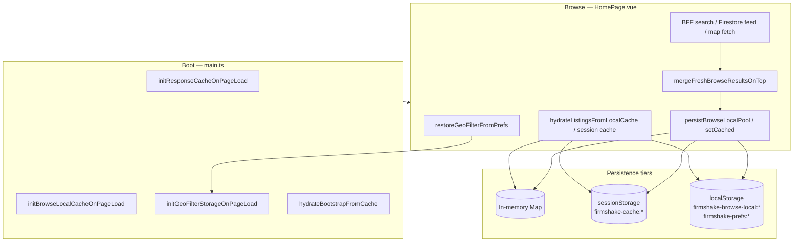

# Browse caching strategy

FirmShake Browse uses a layered stale-while-revalidate (SWR) cache so the tab shell can paint instantly, then refresh in the background. This document describes each layer, read/write paths, invalidation rules, and last-location persistence.

## Architecture



## Cache layers

| Layer | Module | Storage | Scope | TTL | Max size | Hydrate timing |
|-------|--------|---------|-------|-----|----------|----------------|
| Response cache | `responseCache.ts` | sessionStorage + memory | Per-tab session | **5 min** | Browser quota | `main.ts` before Vue mount |
| Browse feed (legacy) | `browseFeedCache.ts` | response cache | Auth uid + community + category | 5 min | First page only; cursor not persisted | HomePage module init (placeholder) |
| BFF search | `browseSearch.ts` | response cache (`browse-search`) | uid + filters + geo + page | 5 min | Page payloads | HomePage `loadInitialListings` |
| Legacy listing search | `listingSearch.ts` | response cache (`listing-search`) | Same (when BFF off) | 5 min | Page payloads | HomePage |
| Browse local pool | `browseLocalStorageCache.ts` | localStorage | uid + filter key or map viewport | **24 h** | **100 summaries** per bucket | HomePage module init + `loadInitialListings` |
| Tab feeds | `tabFeedCache.ts` | response cache | uid (inbox, selling) | 5 min | Full thread/list snapshots | Tab loaders via `useTabFeedLoader` |
| Bootstrap | `appBootstrap.ts` | response cache | communities, profile | 5 min | — | `main.ts` + auth bootstrap |
| Community tab | `browseCommunityStorage.ts` | sessionStorage | **Global** (not uid-scoped) | Session | — | HomePage ref init |
| View mode | `browseViewModeStorage.ts` | sessionStorage | **Global** | Session | — | HomePage ref init |
| **Last geo location** | `geoFilterStorage.ts` | localStorage | **Per uid** | Until cleared / user switch | Single prefs object | HomePage `onMounted` |

### Key structures

**Response cache** — prefix `firmshake-cache:`

```
buildUserCacheKey(uid, namespace, { param=value, ... })
```

Examples:

- `browse-feed:uid=abc&tab=browse&community=all&category=`
- `browse-search:uid=abc&community=all&lat=37.774&lng=-122.419&radiusMiles=10&page=1&...`
- `profile:uid=abc&tab=bootstrap`

**Browse local** — prefix `firmshake-browse-local:`

| Namespace | When used | Key params |
|-----------|-----------|------------|
| `browse-local-all` | Default feed (no text query) | community, category, q, min/max price, **lat, lng, radiusMiles**, sort |
| `browse-local-search` | Text search active | Same filter params |
| `browse-local-map` | Map viewport fetch | lat, lng, radiusMiles, north/south/east/west, **zoom** (coords rounded to 3 decimals) |

**Last location** — prefix `firmshake-prefs:`

```
firmshake-prefs:browse-geo-filter:uid={uid}
```

Owner tracking (user-switch invalidation):

```
firmshake-prefs:browse-geo-filter:owner-uid
firmshake-browse-local:owner-uid
firmshake-cache:owner-uid
```

## Read path (page load → instant paint → background refresh)

1. **`main.ts`** — hydrate response cache memory from sessionStorage; set anonymous owners for browse-local and geo prefs if unset; hydrate bootstrap communities/profile from stale cache.
2. **HomePage module init** — `hydrateBrowsePlaceholder()` reads `browse-local-all` (community + category only, no geo) or legacy `browse-feed` for first paint.
3. **`onMounted`** — `restoreGeoFilterFromPrefs()` loads last geo into `draftGeoFilter` and `appliedGeoFilter`; map mode also sets `mapBounds`.
4. **`loadInitialListings`** — resolve cache key **with applied geo**:
   - Try **localStorage** stale pool (`getStaleBrowseLocalCache`) → paint listings, `loading=false`.
   - Else try **sessionStorage** (`browse-search` page 1 or `browse-feed`).
   - Fetch network with `forceRefresh` when a stale placeholder was shown.
   - **`mergeFreshBrowseResultsOnTop`** — fresh API rows first, cached tail without duplicates.
   - Persist to localStorage (`persistBrowseLocalPool`) and session cache.

Map mode additionally hydrates from `browse-local-map` keys tied to viewport center/radius/zoom.

## Write path (when data is persisted)

| Trigger | What is written |
|---------|-----------------|
| Successful BFF search / load-more | sessionStorage `browse-search`; localStorage pool via `persistBrowseLocalPool` |
| Legacy Firestore feed page 1 | sessionStorage `browse-feed`; localStorage pool |
| Map pan/zoom / geo search | localStorage `browse-local-map` |
| Geo filter apply (sidebar, map Go, Use my location, address pick) | localStorage last-location prefs |
| Full sidebar Apply | Invalidates current listing caches, then fetch + persist |
| Profile / communities bootstrap | sessionStorage profile + communities |
| Tab feed subscription | sessionStorage inbox/selling caches |

**Redundant write avoidance:**

- `saveGeoFilterPrefs` — skips `localStorage.setItem` when prefs unchanged.
- `persistBrowseLocalPool` — skips write when ordered IDs, `hasMore`, and `searchPage` match existing bucket.

## Invalidation rules

| Event | Action |
|-------|--------|
| **User switch** (auth bootstrap) | `clearCacheIfUserChanged` → profile, browse-feed, **browse-search**, **listing-search**, tab feeds |
| | `clearBrowseLocalCacheIfUserChanged` → all `browse-local-*` namespaces |
| | `clearGeoFilterPrefsIfUserChanged` → clears **previous owner's** last-location entry |
| **Filter Apply** (sidebar) | `invalidateCurrentListingCache()` — current browse-feed / browse-search / browse-local keys |
| **Community change** | Instant reload; new cache key (community in key) |
| **Geo clear** | `clearGeoFilterPrefs(uid)`; applied geo nulled; subsequent fetch uses non-geo cache key |
| **Listing unavailable** (map popup) | `removeListingFromAllBrowseLocalCaches(listingId)` — scans all browse-local keys |
| **TTL expiry** | Response cache: 5 min; browse local: 24 h (stale reads still allowed for SWR) |
| **Version mismatch** | Browse local entries with wrong `version` are deleted on read |

### Duplication notes (sessionStorage vs localStorage)

- **sessionStorage (`browse-search`)** — short-lived, page-shaped API responses; good for pagination metadata.
- **localStorage (`browse-local-*`)** — longer-lived listing **pools** keyed by full filter set including geo; survives tab close.
- Overlap is intentional: session cache enables fast same-session revisits; local cache enables next-day instant paint. Fresh fetch always merges on top.

### Known gaps (acceptable tradeoffs)

- `browseCommunityStorage` and `browseViewModeStorage` are not uid-scoped (session-only prefs).
- Initial module-level placeholder ignores geo; corrected before first network fetch in `onMounted`.
- Logout does not reset cache owner uid (pre-existing); login bootstrap clears cross-user data.

## Last-location persistence spec

### Stored fields

| Field | Type | Notes |
|-------|------|-------|
| `lat` | number | Required when saved |
| `lng` | number | Required when saved |
| `radiusMiles` | number | Normalized to supported dropdown values |
| `label` | string? | Display label (short address or reverse-geocoded) |
| `city` | string? | From geocode / address parse |
| `region` | string? | State/province code |

### When saved

- Browse sidebar: **Use my location** (success), address autocomplete select, radius change (when center set), **Clear** removes entry.
- Map toolbar: **Go** (address geocode), **Go to current location**.
- Full sidebar **Apply** when draft geo is copied to applied.

### When restored

- HomePage `onMounted`: both `draftGeoFilter` and `appliedGeoFilter` hydrated; map bounds set when view mode is map.
- User-switch guard runs before hydrate (`clearGeoFilterPrefsIfUserChanged`).

### Integration with map cache keys

Applied geo (`lat`, `lng`, `radiusMiles`) participates in:

- `browse-local-all` / `browse-local-search` filter keys
- `browse-local-map` center/radius (viewport keys add bounds + zoom)

Restoring last location ensures list and map fetches resolve the same filter keys as the previous session.

## Primary modules

| Concern | File |
|---------|------|
| Generic SWR cache | `src/common/services/responseCache.ts` |
| Browse local pools | `src/features/listings/services/browseLocalStorageCache.ts` |
| Last geo location | `src/features/listings/services/geoFilterStorage.ts` |
| BFF search + session cache | `src/features/listings/services/browseSearch.ts` |
| Browse page orchestration | `src/features/listings/views/HomePage.vue` |
| Geo UI | `src/features/listings/components/BrowseGeoFilter.vue` |
| Map geo UI | `src/features/listings/components/BrowseMapView.vue` |
| Auth bootstrap invalidation | `src/common/services/appBootstrap.ts` |
| Unavailable listing bust | `src/features/listings/services/listingStatus.ts` |

## Tests

- `tests/unit/geoFilterStorage.spec.ts` — last-location save/restore, user switch, deduped writes
- `tests/unit/browseLocalStorageCache.spec.ts` — local pool keys, geo in filter keys, map viewport keys
- `tests/unit/responseCache.spec.ts` — session cache TTL and key building
