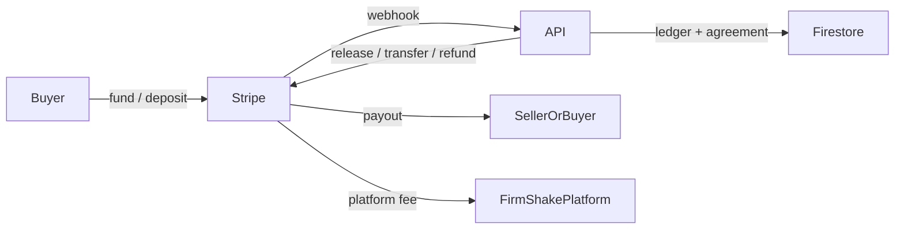

# Deposit escrow & payment processor plan

Plan only — **no implementation** in this document. Completes the Phase 6 payments story sketched in [`MILESTONES.md`](./MILESTONES.md), [`ARCHITECTURE.md`](./ARCHITECTURE.md), and [`BFF_PLAN.md`](./BFF_PLAN.md). Cross-links the App Store payments decision in [`app-store-release-plan.md`](./app-store-release-plan.md).

---

## Executive summary

| Question | Recommendation |
|---|---|
| Who moves / holds money? | **Stripe** (Checkout / PaymentIntents + **Connect** for payouts & marketplace splits) |
| Can Venmo / Cash App be the escrow custodian? | **No** — they are P2P rails, not marketplace escrow APIs |
| How do Venmo / Cash App fit? | **Optional funding & payout rails** where Stripe (or a licensed partner) supports them — not primary custody |
| Wallet? | **Internal ledger** funded by Stripe; avoid open-loop “stored value” that triggers money-transmitter licensing until counsel clears a design |
| Escrow model | Hold buyer deposit in **platform Stripe balance / Connect destination charges** until meetup outcome; then split (offended party + platform fee) |
| App Store v1 | **Product intent updated:** prefer **real deposits in v1** (Stripe escrow) rather than mock-only; mock remains a possible *review* fallback — see [Decisions](#decisions-you-must-make) and [`app-store-release-plan.md`](./app-store-release-plan.md) |
| Presence / anti-fraud | GPS-only “15 ft × 5 min” is **not** a safe sole oracle — see [`deposit-presence-anti-fraud-brainstorm.md`](./deposit-presence-anti-fraud-brainstorm.md) |

**Product rule already in landing copy:** offended party gets **50%** of the deposit as compensation when a FirmShake is broken (`landingCards.ts`); remaining **50%** is the natural place for **platform fee** (confirm exact split in Terms).

### Presence & anti-fraud

Show-up deposits need outcome rules that survive gaming. **Do not** treat client GPS proximity (e.g. both devices within 15 feet for 5 minutes) as the sole definition of a valid FirmShake — accuracy, spoofing, and seller-side attacks break that model. Prefer economic escrow + scheduled pin geofence (supporting) + bilateral handshake (QR / mutual confirm) + explicit defaults when evidence is inconclusive. Full critique and detection brainstorm: [`deposit-presence-anti-fraud-brainstorm.md`](./deposit-presence-anti-fraud-brainstorm.md).

---

## Current state (repo facts)

### Client (`firmshake`)

| Item | Today |
|---|---|
| Default / min deposit | `MEETUP_DEPOSIT_AMOUNT` / `MIN_MEETUP_DEPOSIT_AMOUNT` = **$10** (`src/types/index.ts`) |
| Agreement statuses | `proposed` → `accepted` → `deposit_paid` → `en_route` → `completed` \| `no_show_buyer` \| `no_show_seller` \| `cancelled` |
| Deposit UX | Buyer pays after seller accept (`FirmShakeViewPage`, `MeetupProposalPage`, `FirmShakeInlinePanel`) |
| Payment reality | **Mock** — `confirmMeetupDeposit` marks `deposit_paid` with **no payment verification** (Firestore write path still exists) |
| BFF path | `POST /api/v1/agreements/{id}/deposit` via `confirmMeetupDepositViaBff`; if API returns `mode: stripe` + `checkoutUrl`, client redirects (`window.location.assign`) |
| Compensation copy | Landing: offended party receives **50%** of deposit (`src/features/shell/data/landingCards.ts`) |
| Browse cards | Show `$10 deposit` via constant (not a per-listing Stripe field) |

### API (`firmshake-api`)

| Item | Today |
|---|---|
| Mock deposit | When Stripe **not** configured → Firestore `deposit_paid` immediately (`agreement_pipeline.create_deposit`) |
| Stripe stub | `services/stripe_deposits.py` — Checkout Session `mode=payment`, `payment_method_types=["card"]` only; min **$10** |
| Webhook | `POST /api/v1/webhooks/stripe` — on `checkout.session.completed` → `confirm_deposit_from_stripe_webhook` |
| Authz | `assert_can_confirm_deposit` (buyer only, agreement awaiting deposit) |
| Gaps | No Connect, no escrow hold/release, no wallet ledger, no penalty/payout pipeline, no dispute/chargeback handlers; Checkout is **capture-now payment** (not an authorized hold) |

### Docs / milestones

- Phase 5: mock deposit **done**; Phase 6–7: **Stripe deposits → penalties** ([`MILESTONES.md`](./MILESTONES.md)).
- BFF Phase 3: agreements + Stripe webhook stub; **never** trust client writes for `deposit_paid` in production ([`BFF_PLAN.md`](./BFF_PLAN.md)).
- App Store decision #6: mock vs wait for Stripe ([`app-store-release-plan.md`](./app-store-release-plan.md)).

---

## Honest constraint: Venmo / Cash App vs escrow

```
User expectation                     Reality
─────────────────                    ───────
“Link Venmo → hold deposit           Venmo / Cash App do not expose
 in escrow → pay seller +            third-party marketplace escrow /
 take platform cut”                  custody APIs for apps like FirmShake

What works                           What does not (for v1 escrow)
──────────                           ────────────────────────────
Card / bank via Stripe               Venmo as escrow ledger
Stripe Connect payouts               Cash App as escrow ledger
Venmo as *funding method* where      Direct P2P Venmo between users
 Stripe supports it (region/API)     while FirmShake “holds” funds
Cash App Pay / Instant Payouts       Company custody of user Venmo balances
 where available via Stripe          without a licensed processor
```

**Principle:** FirmShake never “holds Venmo money.” FirmShake holds **Stripe-settled USD** (or ledger claims against Stripe balance) and may later **pay out** via rails users recognize (bank, debit, Instant Payouts, etc.). UI can say “Add funds with Venmo” only when that rail is actually enabled on the Stripe account.

---

## Target architecture

### Roles

| Role | Responsibility |
|---|---|
| **Client** | Start deposit / top-up / payout UX; never confirm payment success from UI alone |
| **firmshake-api** | Create PaymentIntents / Checkout / Connect transfers; verify webhooks; mutate agreement + ledger |
| **Stripe** | PCI, card/bank rails, Connect KYC, settlement, dispute signals |
| **Firestore** | Agreement state, **ledger mirrors** (balances, escrow holds) — source of truth for app UX; Stripe is source of truth for money |

### Recommended money model (phased)



1. **Buyer funds** a deposit (or wallet top-up) via Stripe.
2. Funds sit as an **escrow hold** tied to `agreementId` (see [Escrow lifecycle](#escrow-lifecycle)).
3. On outcome, API instructs Stripe to **release / transfer / refund** and posts **ledger entries**.
4. Platform fee and offended-party compensation are **server-computed**; never client-trusted.

### Why Stripe Connect (not plain Checkout forever)

| Need | Plain Checkout (current stub) | Connect + intents |
|---|---|---|
| Capture deposit | Yes | Yes |
| Hold until meetup outcome | Weak (already captured to platform) | Better with **manual capture**, **separate charges**, or **destination charges** + delayed transfer |
| Pay offended party | Manual ops / transfers awkward | First-class transfers / destination charges |
| Platform cut | Possible but opaque | Explicit application fee / transfer split |
| Seller / buyer KYC for payouts | Missing | Connect onboarding |
| Chargebacks | Platform eats risk alone | Still platform risk, but clearer account structure |

**v1 recommendation:** treat current Checkout stub as a **spike**. Production path:

- Prefer **PaymentIntent** with `capture_method=manual` (authorize → capture on escrow lock) **or** immediate capture into platform + **internal escrow ledger** with delayed Connect transfer (simpler ops, clearer “funds received”).
- Use **Stripe Connect** (Express or Custom) for users who receive compensation / withdrawals.
- Record every movement in an append-only **ledger** (see below).

**Default preference for FirmShake’s $10 deposits:** capture-immediately + internal escrow ledger. Manual-capture auth windows are short and awkward for meetups scheduled hours/days out; once funds are captured, ledger state + delayed Connect transfer is easier to reason about for 50/50 splits.

---

## Wallet / ledger design

### Goal

Users may **load money first**, then apply balance to meetup deposits — without FirmShake becoming an unlicensed bank.

### Recommended approach: “prepaid credit ledger” backed by Stripe

| Concept | Definition |
|---|---|
| **Wallet balance** | Sum of ledger credits − debits for `userId` (USD cents, integer) |
| **Escrow hold** | Ledger entry type that **reduces available** balance and tags `agreementId` until release |
| **Available** | `balance − sum(open holds)` |
| **Funding** | Stripe PaymentIntent / Checkout top-up → webhook → `credit` ledger |
| **Spend** | Deposit → `hold` (or transfer from available → escrow) |
| **Release** | Meetup complete → `release_hold` + optional `refund` credit to buyer |
| **Forfeit / split** | No-show → debit escrow; credit offended party; credit platform fee |

### What to store (Firestore sketch)

```
users/{uid}/wallet/main          { availableCents, heldCents, currency, updatedAt }
ledgers/{entryId}                append-only
  userId, type, amountCents, agreementId?, stripeEventId?, stripePaymentIntentId?,
  idempotencyKey, createdAt, meta

escrows/{agreementId}            { status, amountCents, buyerId, stripePaymentIntentId?,
                                   heldAt, releasedAt?, outcome? }
```

**Rules:**

- [ ] All balance changes are **append-only ledger rows**; balance fields are derived or dual-written in a transaction.
- [ ] Idempotency on `stripeEventId` / client `idempotencyKey` — webhooks retry.
- [ ] Never decrement balance from the client; only firmshake-api after Stripe confirmation.
- [ ] Cap max wallet balance and max open escrows per user (velocity / AML).

### Money-transmitter caution (stored balances)

Stored user balances that can be withdrawn as cash often attract **money transmitter / stored-value** regulation (US federal + state; FinCEN; possible BitLicense-style regimes if crypto later).

| Safer product framing (default) | Riskier framing |
|---|---|
| “Credits for FirmShake deposits” — redeemable only for deposits / in-app obligations; limited cash-out | “Cash wallet” with free withdrawal to Venmo anytime |
| Short TTL on unused credits; auto-refund path via Stripe | Indefinite stored value |
| Counsel-reviewed Terms + Privacy before launch | Ship wallet without legal review |

**Checklist before building wallet UI:**

- [ ] Confirm with counsel: closed-loop credits vs open-loop wallet.
- [ ] If cash-out required: prefer **Stripe Connect payouts** + KYC, not “Venmo link = custody.”
- [ ] Document refund policy for unused credits.
- [ ] Do **not** market Venmo/Cash App as FirmShake-held balances.

---

## Escrow lifecycle

Maps to the existing agreement state machine; extends it with payment objects.

### Happy path

| Step | Agreement status | Money / ledger |
|---|---|---|
| Buyer proposes | `proposed` | None |
| Seller accepts | `accepted` | Deposit **due** |
| Buyer pays / applies wallet | stays `accepted` until webhook | Stripe auth/capture or wallet → **escrow hold** |
| Webhook confirms funds | → `deposit_paid` | `escrows/{id}.status = held` |
| Either party en route | `en_route` | Still held |
| Both complete meetup | `completed` | **Release** full deposit to buyer (refund) **or** policy: release after confirm — product decision |
| Cancel before meetup (mutual / policy) | `cancelled` | Refund to buyer (minus optional cancel fee — product decision) |

### Broken FirmShake (product rule)

Landing copy: offended party gets **50%**; imply platform keeps **50%**.

| Outcome | Agreement status | Suggested money split (confirm in Terms) |
|---|---|---|
| Buyer no-show | `no_show_buyer` | 50% → seller Connect payout; 50% → platform |
| Seller no-show | `no_show_seller` | 50% → buyer (refund/credit); 50% → platform |
| Dispute / unclear | (new) `disputed` | Hold until admin / evidence window; then same split or full refund |

**Must decide:** who can mark no-show, evidence window, auto vs manual, and whether **both** parties can claim (see [Decisions](#decisions-you-must-make)).

### Example money flow ($10 deposit)

| Event | Buyer | Offended party | Platform | Stripe |
|---|---|---|---|---|
| Deposit paid | −$10 (or −$10 wallet) | — | — | +$10 platform balance (held in ledger) |
| Completed meetup | +$10 refund/credit | — | $0 (or policy fee) | refund / reverse |
| Buyer no-show | $0 back | +$5 | +$5 | Connect transfer $5 + retain $5 |
| Seller no-show | +$5 | (buyer is offended) | +$5 | refund/credit $5 + retain $5 |

### Implementation checklist (API)

- [ ] Replace mock `create_deposit` success path: **never** set `deposit_paid` without Stripe webhook (or wallet debit confirmed in same API transaction).
- [ ] Persist `stripePaymentIntentId` / `checkoutSessionId` on agreement or escrow doc.
- [ ] Webhook handlers (idempotent): `payment_intent.succeeded` / `amount_capturable_updated` / `checkout.session.completed` / `charge.dispute.created` / `transfer.paid` / `payout.failed`.
- [ ] Outcome endpoints that **trigger release/split**, not only status flips (`complete`, no-show buyer/seller, cancel-with-refund).
- [ ] Admin override endpoint for disputes (super-admin only, audit log).
- [ ] Firestore rules: client **cannot** write `deposit_paid`, escrow, or ledger (align with BFF deny-write plan).

### Client checklist

- [ ] Deposit button: create session / confirm PaymentSheet → wait for agreement listener → `deposit_paid`.
- [ ] Remove trust in local “Deposit confirmed” without server status.
- [ ] Pass `successUrl` / `cancelUrl` (web) or PaymentSheet (native Capacitor) per platform.
- [ ] Show escrow / wallet balances from API, not invented client math.
- [ ] Retire prod use of `agreementFirestoreWrites.confirmMeetupDepositViaFirestore`.

---

## Venmo & Cash App — phased rails

| Phase | Scope | Notes |
|---|---|---|
| **P0** | Cards (+ Link) via Stripe | Ship escrow + splits; matches current stub direction |
| **P1** | US bank debit / ACH where useful for top-ups | Lower fees; slower settlement — bad for same-day meetup unless wallet prefunded |
| **P2** | Enable Stripe-supported **Cash App Pay** / **Venmo** as *payment method types* if account + region allow | Funding only; still settles in Stripe |
| **P3** | Connect **Instant Payouts** / standard bank payouts for compensation | User links bank (or debit); UI may say “Cash out” — not “Cash App escrow” |
| **Later** | Deep “Link Venmo account” branding | Only if a licensed partner or Stripe product explicitly supports it; do not scrape Venmo |

**Checklist:**

- [ ] In Stripe Dashboard, inventory which PM types are enabled for the FirmShake account (US).
- [ ] Do not promise Venmo/Cash App in App Store / marketing until P2 verified in test mode.
- [ ] Keep method selection server-driven (`payment_method_types` from API config).

---

## Risk controls

### Identity / KYC

| Actor | When | Mechanism |
|---|---|---|
| Buyer funding deposits | Always | Stripe Radar + card checks; optional Stripe Identity if high velocity |
| Anyone receiving **payouts** (seller compensation, withdrawals) | Before first payout | **Stripe Connect onboarding** (SSN/EIN, bank) |
| Platform | Launch | Stripe account KYC, business verification |

- [ ] Gate “Receive compensation” behind Connect `charges_enabled` / `payouts_enabled`.
- [ ] Mirror Connect account status on `users/{uid}` for UX.
- [ ] Align with existing MFA for high-risk actions (`auth_time` freshness — already noted in BFF security checklist).

### Velocity & fraud

- [ ] Max deposits / day / user and / device.
- [ ] Max concurrent open escrows per user.
- [ ] Max wallet top-up per day; cool-down after chargeback.
- [ ] Block list integration: blocked pairs cannot create deposits.
- [ ] Radar rules: high-risk cards require 3DS (`payment_method_options`).
- [ ] New accounts: lower limits until N successful completed meetups.

### Chargebacks & disputes

| Event | Response |
|---|---|
| `charge.dispute.created` | Freeze related escrow/payout; flag agreement; notify ops |
| Evidence window | Export meetup logs (timestamps, ETA pings, accept/deposit times) — **no raw GPS to other party**, but server has audit trail |
| Lost dispute | Ledger write-down; clawback Connect transfer if possible; user negative balance policy |

- [ ] Never auto-payout compensation until **capture settled** + dispute window policy (e.g. delay payout N days for card deposits).
- [ ] Prefer wallet credits for small $10 flows to reduce card-dispute surface once funded.

### Operational disputes (who showed up)

- [ ] Define evidence: mutual “complete,” timer after `meetupAt`, photo check-in (future), admin review.
- [ ] Default: if neither confirms, auto-refund after TTL (product decision).
- [ ] Rate-limit no-show claims; penalty for false claims (future trust score).
- [ ] Do **not** auto-settle money from GPS-only proximity; see [`deposit-presence-anti-fraud-brainstorm.md`](./deposit-presence-anti-fraud-brainstorm.md).

---

## Security

### PCI minimization

- [ ] **No raw card data** on FirmShake servers or in Firestore.
- [ ] Use Stripe Checkout (web) and/or Payment Element / PaymentSheet (native Capacitor).
- [ ] Prefer Stripe-hosted or Stripe.js fields only.

### Webhooks & API

- [ ] Verify `Stripe-Signature` (`STRIPE_WEBHOOK_SECRET`) — stub exists; **require** in prod.
- [ ] Reject events with unknown/replayed IDs (store processed `event.id`).
- [ ] All payment mutations on firmshake-api only; Firebase ID token on user-initiated routes.
- [ ] Secrets in Cloud Run Secret Manager (not client env).
- [ ] Alerts on webhook failures / signature errors (BFF observability checklist).

### App / data

- [ ] Agreement deposit confirmation **not** writable from client rules once live.
- [ ] Audit log for admin escrow releases.
- [ ] Least-privilege service account (no Stripe secret key in client).

---

## App Store / Play — physical-goods deposits

FirmShake deposits secure **in-person physical-goods meetups**, not digital content unlocks.

| Topic | Guidance |
|---|---|
| **IAP** | Generally **not** required for real-world goods / person-to-person arrangements paid externally — but Apple review is fact-specific. Document in review notes: “Deposit holds for offline meetup; goods are physical; paid via Stripe.” |
| **Reader apps / external links** | If you only link out to web checkout, follow current Apple external-payment rules for your category; PaymentSheet in-app via Stripe is usually cleaner for Cap apps. |
| **Mock deposits in v1.0** | Still usable as a **review fallback** if Stripe is not ready; product intent is **live deposits in v1** when escrow ships ([`app-store-release-plan.md`](./app-store-release-plan.md) § Payments; anti-fraud floor in [`deposit-presence-anti-fraud-brainstorm.md`](./deposit-presence-anti-fraud-brainstorm.md)). |
| **Live payments later** | Update Privacy nutrition label (Purchase History / Financial Info), Terms, and review notes; expect re-review. |
| **Account deletion** | Must cover wallet/escrow residual balances (refund or forfeit policy). |

**Checklist:**

- [ ] Decide App Store v1: **live Stripe deposits** (preferred product intent) vs **mock** only if Stripe slips (Decision #6 in app-store plan).
- [ ] Privacy Policy + Terms sections: deposits, 50/50 split, chargebacks, wallet credits.
- [ ] When Stripe ships: refresh App Privacy labels + support URL FAQ.

---

## Phased delivery plan

### Phase A — Foundations (1–2 weeks) — design + legal gate

- [ ] Lock product decisions in [Decisions](#decisions-you-must-make).
- [ ] Counsel pass on wallet / money-transmitter posture.
- [ ] Stripe account: Connect platform enabled; webhook endpoints sketched.
- [ ] Write ledger + escrow schema ADR (can live as section in this doc until code).

### Phase B — Real deposit capture (2–3 weeks) — replace mock

- [ ] Productionize `stripe_deposits.py`: PaymentIntent or Checkout with metadata `agreementId`, `buyerId`.
- [ ] Client: success/cancel URLs + native PaymentSheet path.
- [ ] Webhook → only path to `deposit_paid`.
- [ ] Disable mock mode in staging/prod (`STRIPE_*` required).
- [ ] E2E: accept → pay test card → status `deposit_paid`.
- [ ] Unit tests: idempotent webhook, wrong buyer, wrong status.

### Phase C — Escrow release & 50/50 split (2–3 weeks)

- [ ] Outcome endpoints: complete, no-show buyer/seller, cancel-with-refund.
- [ ] Connect onboarding for payout recipients.
- [ ] Transfer / application fee / refund implementation + ledger.
- [ ] Admin dispute hold.
- [ ] Delay payout policy for chargebacks.

### Phase D — Wallet top-up (2 weeks)

- [ ] Top-up PaymentIntent → credit ledger.
- [ ] Pay deposit from available balance (atomic hold).
- [ ] Caps, TTL, refund-unused-credits.
- [ ] UX: balance on profile / FirmShake pay sheet.

### Phase E — Venmo / Cash App rails (optional, 1–2 weeks+)

- [ ] Enable supported PMs in Stripe; feature-flag per platform.
- [ ] Marketing copy only after test-mode success on US accounts.
- [ ] Instant payouts for compensation (optional).

### Phase F — Hardening

- [ ] Radar / 3DS defaults, velocity limits, ops runbooks.
- [ ] Chargeback evidence exporter.
- [ ] Metrics: deposit conversion, no-show rate, dispute rate, webhook lag.

---

## Mapping to existing code (when implementing later)

| Area | Touchpoints |
|---|---|
| Client types | `AgreementStatus`, `MEETUP_DEPOSIT_*` in `src/types/index.ts` |
| Client deposit | `confirmMeetupDepositViaBff` in `src/common/services/api.ts` — extend for PaymentSheet / wallet |
| Client mock writes | `agreementFirestoreWrites.confirmMeetupDepositViaFirestore` — retire for prod |
| Client router | `agreementServiceRouter.confirmMeetupDeposit` (BFF vs Firestore) |
| API deposit | `agreement_pipeline.create_deposit`, `stripe_deposits.py` |
| API webhook | `routes/v1/agreements.py` `POST /webhooks/stripe` |
| Authz | `agreement_authorization.assert_can_confirm_deposit` |
| Docs | This file; update `MILESTONES` Phase 6 when live; App Store decision when chosen |

---

## Decisions you must make

Resolve before Phase B coding:

1. **App Store v1 payments** — **Current product intent: real deposits in v1** (Stripe Phase B/C on critical path). Mock remains only as a review/logistics fallback if Stripe slips. *(Align with decision #6 in [`app-store-release-plan.md`](./app-store-release-plan.md).)* Presence / no-show oracle: [`deposit-presence-anti-fraud-brainstorm.md`](./deposit-presence-anti-fraud-brainstorm.md).
2. **Escrow technical model** — Manual-capture PaymentIntents vs **capture-immediately + internal ledger holds** (recommended default)?
3. **Completed meetup** — Full refund of deposit to buyer, or forfeit as “service fee,” or partial?
4. **Cancel after `deposit_paid`** — Full refund? Window before `meetupAt`? Fee?
5. **No-show authority** — Mutual confirm, unilateral claim + evidence window, or admin-only?
6. **Split** — Confirm **50% offended / 50% platform** in Terms (or change landing copy).
7. **Wallet scope** — Closed-loop credits only vs cash-out; max balance; counsel sign-off.
8. **Who gets Connect accounts** — Sellers only, or any user who might receive compensation (buyers on seller no-show)?
9. **Payout delay** — Days to wait post-meetup before transferring compensation (chargeback buffer)?
10. **Venmo / Cash App promise** — Marketing now (risky) vs after Phase E verified?
11. **Entity / banking** — US entity, Stripe country, tax reporting (1099-K thresholds) for payouts.
12. **Support ops** — Who handles disputes in v1 (founder inbox vs tooling)?

---

## Out of scope (this plan)

- Implementing Stripe Connect / wallet code (track in firmshake-api + client milestones).
- Full item purchase escrow for listing price (this plan is **meetup deposit** only; item price stays cash/in-person unless a later “pay for goods” milestone).
- Crypto rails.
- Non-US launch specifics (add a follow-on when expanding).

---

## Success criteria

- [ ] Buyer cannot reach `deposit_paid` without Stripe (or ledger) confirmation.
- [ ] Offended-party split + platform fee execute server-side with audit trail.
- [ ] No PCI card data on FirmShake infrastructure.
- [ ] Webhooks idempotent; mock path disabled in prod.
- [ ] Terms / Privacy / App Store notes match actual money behavior.
- [ ] Venmo/Cash App mentioned in product only where Stripe rails actually work.
- [ ] Counsel OK on wallet / stored-value posture.

---

## Related docs

| Doc | Relevance |
|---|---|
| [`MILESTONES.md`](./MILESTONES.md) | Phase 6 Stripe deposits / penalties |
| [`ARCHITECTURE.md`](./ARCHITECTURE.md) | Deposit-backed trust principle |
| [`BFF_PLAN.md`](./BFF_PLAN.md) | Agreements BFF, webhook-only payment confirmation |
| [`app-store-release-plan.md`](./app-store-release-plan.md) | Store review payments decision + privacy hotspots |
| [`deposit-presence-anti-fraud-brainstorm.md`](./deposit-presence-anti-fraud-brainstorm.md) | Critique of GPS presence rules; buyer/seller gaming; v1 anti-fraud floor |
| firmshake-api `services/stripe_deposits.py` | Existing Checkout stub to replace/extend |
